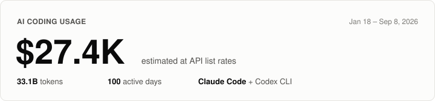

## Hi, I'm mj

MLOps engineer. I build and maintain infrastructure for machine learning systems.

### AI coding usage

<picture>
  <source media="(prefers-color-scheme: dark)" srcset="usage-card-dark.svg">
  
</picture>

